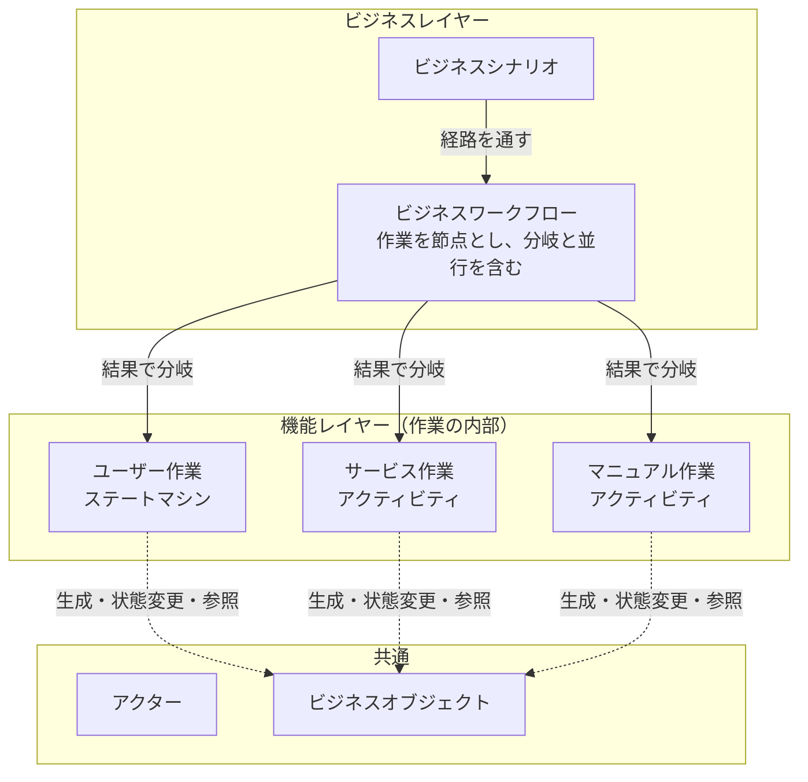

# bizspec

**業務をモデルとして記述し、「このシステムで業務が回ることを、どこまで確かめれば十分と言えるか」を決定論的に測るためのツールセットです。**

> **状態：構想段階**
> 実装はまだありません。このリポジトリーにあるのは、概念設計の検討結果を整理した文書です。
> 確定した事項と、提案・未決の事項が混在しているため、各文書では【確定】【提案】【未決】を明示しています。

## 何をするものか

bizspecの目的はシステム開発です。対象システムを開発するために、その前提となる業務を設計し、モデルとして記述します。

モデルからは次のものを導きます。

- 文書としてのビュー（業務フロー図、仕様書など）
- テストケース（ビジネステストと機能テスト）
- テストの十分性の評価（網羅率と、未網羅経路への理由付きの判断）

進め方は次の3段階です。

1. 生成したビューを通じて、人がモデルの妥当性に合意する。
2. モデルから、確かめるべきことを決定論的に導く。
3. 確かめていないことを、理由付きで判断する。

詳しくは [目的と保証範囲](docs/purpose.md) を参照してください。

## 全体像

| | ビジネスレイヤー | 機能レイヤー |
|---|---|---|
| モデルの単位 | ビジネスワークフロー | 作業の内部（ステートマシンまたはアクティビティ） |
| シナリオ | 作業をまたいで業務を通すビジネスシナリオ | 作業の内部を通すシナリオ |
| テスト | ビジネステスト | 機能テスト |
| 評価 | 機能レイヤーと同等の評価を適用する | ucspecの評価 |

## ucspecとの関係

[ucspec](https://github.com/nuitsjp/ucspec) は、ユースケースを視点として、状態遷移モデル・シナリオ・網羅率を扱うCLIです。bizspecは視点を一段上げて業務全体を扱い、ucspecを内包するフルスペックのツールセットとして構築します。

内包の具体的な方法は未決です。bizspecが前提にしているucspecの理解は [ucspecの現状理解](docs/ucspec-baseline.md) にまとめています。

## 文書

| 文書 | 内容 |
|---|---|
| [目的と保証範囲](docs/purpose.md) | 何のためのツールか、何を保証し、何を保証しないか |
| [用語集](docs/glossary.md) | このプロジェクトで使う言葉の定義 |
| [概念モデル](docs/concept-model.md) | モデルの要素と関係 |
| [検査と評価](docs/evaluation.md) | 構造検査、網羅率、未網羅の評価 |
| [決定記録](docs/decisions.md) | 確定した事項と、提案中の事項の一覧 |
| [未決事項](docs/open-issues.md) | これから決める必要がある事項 |
| [ucspecの現状理解](docs/ucspec-baseline.md) | 出発点としたucspecの機能と原則 |

## 状態の読み方

| 表記 | 意味 |
|---|---|
| 【確定】 | 方針として決定した事項 |
| 【提案】 | 検討の中で出た案。まだ決定していない |
| 【未決】 | 決める必要があるが、案も固まっていない事項 |

最初に読む場合は、[目的と保証範囲](docs/purpose.md)、[概念モデル](docs/concept-model.md)、[未決事項](docs/open-issues.md) の順をお勧めします。
