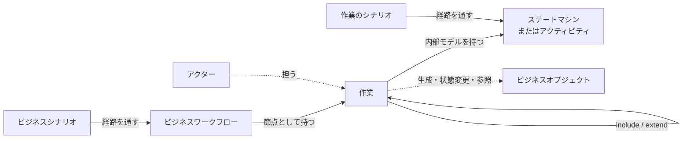

# 概念モデル

bizspecのモデルを構成する要素と、その関係です。記述形式（ファイル形式やスキーマ）はまだ決めていません。ここで扱うのは概念の水準です。

## 1. 全体構成

モデルは、共通の要素、ビジネスレイヤー、機能レイヤーの3つの部分からなります。

## 2. 共通の要素

### アクター

作業の担い手です。両レイヤーで共有します。【提案】

### ビジネスオブジェクト

業務が扱う対象です。

- **導出する**【確定】
  ビジネスオブジェクトは導出します。導出の手順や手法は限定しません。ビジネスワークフローの設計時に出ても、その下の作業の設計時に出ても、必要なら受け入れます。
- **状態を持つ**【提案】
  ビジネスオブジェクトは名前と状態を持ちます。状態は有限で数え上げられるため、検査と網羅率に使えます。
- **属性を持たない**【提案】
  属性（データ項目）は検査に使いません。

#### 状態を持たせる理由

- 各作業の前提と結果を状態で書けるので、「前提の状態を、先行するどの経路も作っていない」といった矛盾を機械的に検出できます。
- 別々のワークフロー（受注と請求など）が、同じオブジェクトの状態を介してつながります。
- ワークフローの経路網羅とは別に、ライフサイクルがどこまで通されたかを測れます。経路をすべて通しても到達していない状態を拾えます。
- 並行する枝が同じオブジェクトの状態を変える、という衝突を検出できます。
- 状態名は業務の言葉そのものなので、顧客と合意できます。

1つのオブジェクトが独立した複数の状態軸（支払状況と出荷状況など）を持つ場合があるため、状態は軸ごとに分けて持てる形が必要です。

#### 属性を持たせない理由

- 属性値は取りうる範囲が事実上無限で、検査に使うには条件式の評価が必要になります。ツールが業務ロジックの記述言語に近づきます。
- 属性に対する網羅は同値分割や境界値の技法の領域で、グラフの経路網羅では定義できません。
- 属性の正本はデータモデルやコードにあり、仕様にも書くと二重管理になります。
- 属性は頻繁に変わりますが、業務の流れにはほとんど影響しません。

#### 属性を持たないことの弱点

- 属性に依存する分岐（金額が一定以上なら上位者の承認、など）は、名前付きの分岐で表し、閾値は文章で書くことになります。
- ツールは具体的なテストデータを生成できません。境界値の検証は実装のテストに委ねます。

折衷案として、属性を「検査に使わない説明項目」として書けるようにするか、外部のデータモデルへの参照を持たせる方法があります。【未決】

## 3. ビジネスレイヤー

### ビジネスワークフロー

作業を節点とし、順序と分岐を辺とするモデルです。

- **並行を受け入れる**【確定】
  並行する作業と待ち合わせを記述できます。
- **メンテナンスも対象にする**【確定】
  マスターメンテナンスもビジネスとして定義します。マスターメンテナンスから該当業務への反映を確認するフローを、厳密には業務フローではないものの、定義して管理します。
- **フローに種別を持たせる**【提案】
  評価とテスト構築の上では同じ扱いにし、種別（業務フロー、反映確認フロー）だけを区別します。顧客向けの業務フロー図には業務フローだけを出す、といったビューの出し分けに使います。

この結果、すべての作業が何らかのフローに属することになり、ビジネステストの評価が全作業に届きます。

### ビジネスシナリオ

ビジネスワークフローを通す経路と、その目的・期待結果です。ビジネステストの源になります。【提案】

## 4. 作業

### 3つの種類【確定】

| 種類 | 内容 | 内部モデル |
|---|---|---|
| ユーザー作業（仮称） | ユーザー操作を伴う作業 | ステートマシン図 |
| サービス作業 | システムが単独で実施する作業（バッチ、サービスなど） | UMLのアクティビティ図 |
| マニュアル作業 | システムを利用しない作業 | UMLのアクティビティ図 |

マニュアル作業は、その結果によってビジネスフローに影響を与える可能性があります。そのため、マニュアル作業にも内部の分析・設計を行います。【確定】

ユーザー作業の内部は、ucspecと同じく、プロダクトで共有するステートマシンに対する範囲として表す想定です。【提案】

### 作業が共通して持つもの【提案】

3種類の作業は、内部モデルの形が違うだけで、次のものを共通して持ちます。

- 目的
- 担い手（アクター）
- 結果（名前付きの終わり方）
- シナリオ

### 定義と出現の分離【提案】

同じ作業が、複数のワークフローや複数の箇所で使われます。作業の定義と、ワークフロー上での出現（呼び出し）を分けることで再利用できます。

## 5. 作業間の関係

ユースケースのinclude・extendに相当する概念を、作業に持ち込みます。【確定】

| 関係 | 意味 | 例 |
|---|---|---|
| include | ある作業が別の作業を必ず呼び出す | 受注登録が顧客検索を含む |
| extend | 条件が成り立つときだけ、別の作業が拡張点に差し込まれる。基本の作業はそれだけで完結する | 高額の場合だけ与信照会が入る |

- **種別をまたぐ関係を認める**【確定】
  たとえば在庫引当のサービス作業を、画面のユーザー作業と夜間バッチの両方から呼べます。ステートマシンからアクティビティを呼ぶ場合などの接続の定義は未決です。
- **呼ぶ側は結果だけを見る**【確定】
  includeされた作業は、呼ぶ側の網羅率では結果だけを分岐として数えます。呼ばれる作業の内部は、その作業自身のシナリオで評価します。

### フローでの接続との使い分け【提案】

同じことを2通りに書けてしまうため、基準が必要です。

- 担い手、時点、場所のいずれかが変わるなら、ビジネスワークフロー上の順序として書く。
- 同じ担い手による一続きの実行の中で完結するなら、include・extendで書く。

## 6. 作業とビジネスオブジェクトの関係

| 関係 | 例 | 状態 |
|---|---|---|
| 生成 | 受注登録が受注を作る | 【提案】 |
| 状態変更 | 承認が受注を承認済みにする | 【提案】 |
| 参照 | 受注登録が商品マスターを読む | 【確定】 |

参照の関係を持つことで、マスターを変更する作業と、そのマスターを参照する作業の組を列挙できます。この組のうち反映確認フローで通されていないものを、検査の対象にします。【確定】

属性を持たない前提では、「何が反映されるか」はシナリオの期待結果に文章で書きます。

## 7. レイヤー間の接続【提案】

3種類の作業すべてが、名前付きの結果を持ちます。ビジネスワークフローの分岐は、この結果の名前だけを参照します。

- ビジネステストは、作業の内部の経路を問いません。
- 機能テストは、業務の流れを問いません。
- ワークフローから作業へ、作業から含まれる作業へ、どの段でも「結果の名前だけを見る」という同じ原則で接続します。

マニュアル作業の結果がフローに影響する、という要件も、この形で他の作業と同じ扱いになります。

## 8. ユースケースという概念の扱い

ucspecのユースケースは、モデルそのものではなく、次の4つを束ねる単位です。

1. 目的
2. アクター
3. 共有ステートマシンに対する範囲と、開始・終了
4. シナリオ

bizspecでは、作業がこの4つを持ちます。そのため、モデル要素としてのユースケースは作業に統合できる、というのが現在の方向です。include・extendを作業に持ち込む決定と、メンテナンスをビジネスとして定義する決定は、この方向を前提にしています。

ただし、ユースケースを廃止するという明示の決定はまだありません。「ユースケース」という言葉を、アクターと作業の関係を示す生成ビューの名前として残す案もあります。[未決事項](open-issues.md) を参照してください。
