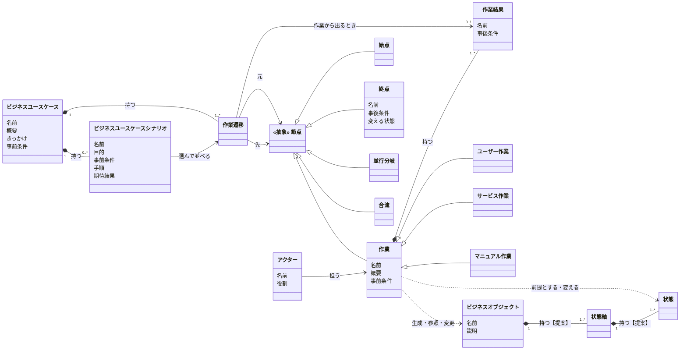
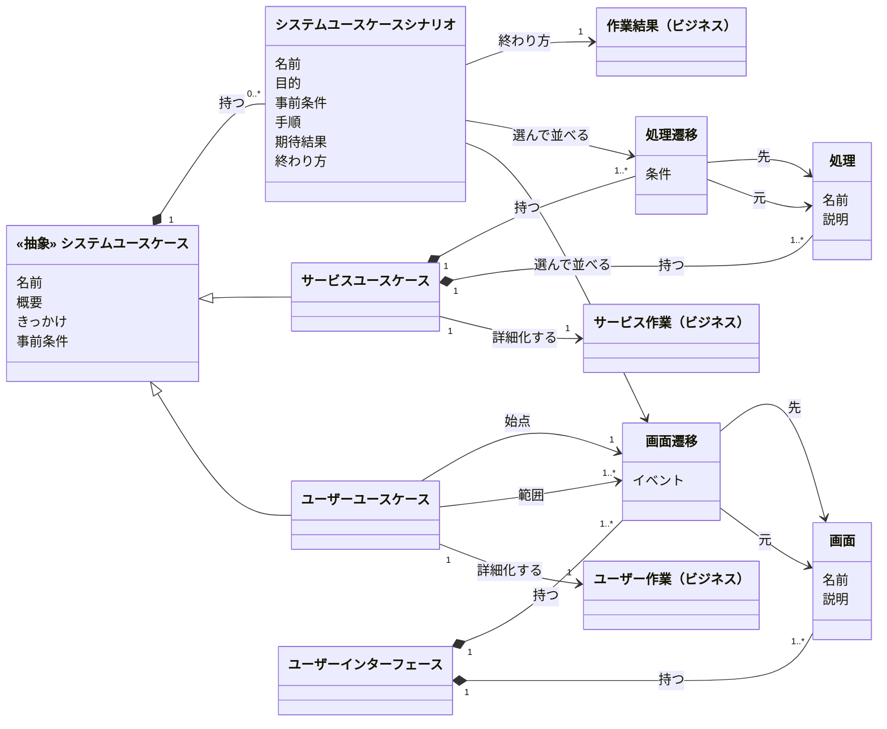

# 概念モデル

## 1. 構成

モデルは、論理モデルと実装ビューからなります。

| 区分 | 内容 |
|---|---|
| 論理モデル | ビジネスレイヤーとシステムレイヤー。これだけで概念の構造が閉じる |
| 実装ビュー | 論理モデルをBPMNとUMLで表す。論理モデルを参照するだけで、論理モデルからは参照されない |

依存の向きは、実装ビューから論理モデル、システムレイヤーからビジネスレイヤーの一方向です。

どのユースケースも、次の2つで記述します。

- **静的モデル**：節と、節をつなぐ遷移。
- **動的モデル**：静的モデルの遷移を選んで並べたシナリオ。テストの源になります。

## 2. ビジネスレイヤー

| 概念 | 定義 |
|---|---|
| ビジネスユースケース | 業務の単位。作業遷移の集まりとして静的モデルを持つ。マスターメンテナンスも1つのビジネスユースケースとして扱う |
| ビジネスユースケースシナリオ | 作業遷移を選んで並べたもの。ビジネスユースケーステストの源になる |
| 節点 | 作業遷移の両端になるもの。作業、始点、終点、並行分岐、合流の5種類がある |
| 作業 | 業務の1つの仕事。複数のビジネスユースケースで共有する。1つのビジネスユースケースの中には1回だけ現れる |
| 作業結果 | 作業の名前付きの終わり方（承認、差戻しなど）。作業結果ごとに事後条件を持つ |
| 作業遷移 | 節点から節点への線。元が作業のときは、その作業の作業結果を1つ指す |
| 始点、終点 | ビジネスユースケースの始まりと終わり。終点は名前、事後条件、変える状態を持つ |
| 並行分岐、合流 | 並行する作業の始まりと終わり |
| ユーザー作業 | ユーザーの操作を伴う作業。呼称は仮【未決】 |
| サービス作業 | システムが単独で行う作業（バッチ、サービスなど） |
| マニュアル作業 | システムを使わない作業。内部はビジネスレイヤーで定義する【未決】 |
| アクター | 作業の担い手。システムレイヤーからも参照する |
| ビジネスオブジェクト | 業務が扱う対象（経費申請、受注など）。システムレイヤーからも参照する |
| 状態軸、状態 | ビジネスオブジェクトの状態。独立した軸ごとに持つ【提案】 |

作業とビジネスオブジェクトの関係（生成、参照、変更、状態を前提とする、状態を変える）の記述範囲は未決です（[O-05](open-issues.md#o-05-ビジネスオブジェクトの記述範囲)、[O-06](open-issues.md#o-06-状態の前提と変化の書き場所)）。

## 3. システムレイヤー

| 概念 | 定義 |
|---|---|
| システムユースケース | システムの単位。ユーザーユースケースとサービスユースケースの2種類がある |
| ユーザーユースケース | ユーザー作業を1対1で詳細化する。画面遷移を持たず、ユーザーインターフェースの画面遷移の一部を範囲と始点で指す |
| サービスユースケース | サービス作業を1対1で詳細化する。処理と処理遷移をユースケースごとに持つ |
| ユーザーインターフェース | 画面と画面遷移を持つ。ユースケースとは独立に作り、複数のユーザーユースケースから使われる |
| 画面、画面遷移 | ユーザーインターフェースの状態と、その間の遷移。画面遷移はアクターの操作（イベント）で起こる |
| 処理、処理遷移 | サービスユースケースの手順と、その間の遷移。処理遷移は条件を持てる |
| システムユースケースシナリオ | 遷移を選んで並べたもの。終わり方として、詳細化する作業の作業結果を1つ宣言する |

マニュアル作業は、システムユースケースを持ちません。

## 4. 実装ビュー

| 実装ビュー | 要素 | 表す論理モデルの概念 |
|---|---|---|
| BPMN | プロセス | ビジネスユースケース |
| | シーケンスフロー | 作業遷移 |
| | フローノード | 節点 |
| | タスク（ユーザー、サービス、マニュアル） | 作業 |
| | 開始イベント、終了イベント | 始点、終点 |
| | 並行ゲートウェイ | 並行分岐、合流 |
| | 排他ゲートウェイ | 作業結果による分岐 |
| | レーン | アクター |
| UML ステートマシン図 | ステートマシン | ユーザーインターフェース |
| | 状態 | 画面 |
| | 遷移 | 画面遷移（トリガーがイベント） |
| UML アクティビティ図 | アクティビティ | サービスユースケース（1つにつき1枚） |
| | アクション | 処理 |
| | 制御フロー | 処理遷移（ガードが条件） |

論理モデルの作業と作業結果は、BPMNではタスクと排他ゲートウェイの2つの要素になります。作業結果が1つの作業には、排他ゲートウェイを置きません。

## 5. 構造の規則

次の規則は、図では表さず、構造検査で確かめます。

- 作業から出る作業遷移は、その作業の作業結果を1つ指す。
- 作業結果1つにつき、出ていく作業遷移は、ビジネスユースケースごとにちょうど1本ある。
- 始点へ入る遷移と、終点から出る遷移はない。
- ユーザーユースケースの始点は、範囲に含まれる。
- シナリオが選ぶ遷移は、そのユースケースの範囲または処理遷移に含まれる。
- システムユースケースシナリオの終わり方は、詳細化する作業の作業結果である。
- 対応するシステムユースケースがないユーザー作業とサービス作業を示す。
- 同じビジネスオブジェクトについて、変更する作業の後に参照する作業を通すビジネスユースケースシナリオがない組を示す。

網羅率は、共有される遷移をプロダクト全体で一度だけ数えます。指標は未決です（[O-04](open-issues.md#o-04-網羅率の指標と並行の数え方)）。
