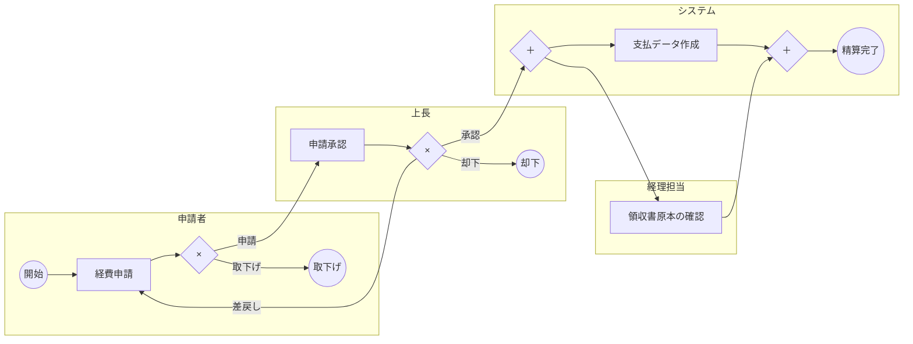
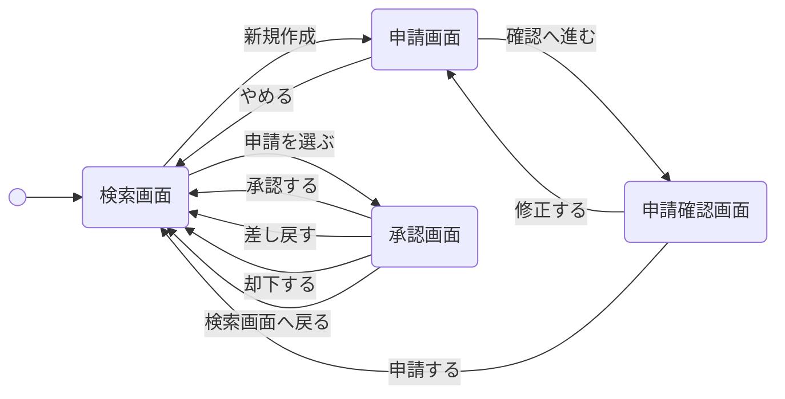
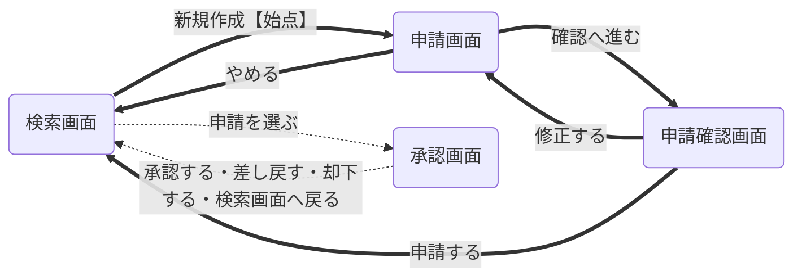
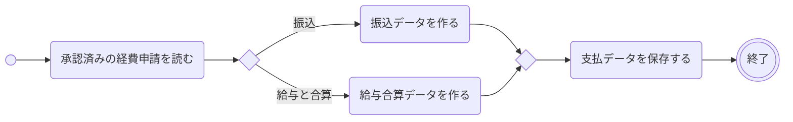

# 記述例：経費精算

モデルから生成する仕様書の例です。業務の内容は説明用の架空のものです。

## ビジネスユースケース：経費精算

| 項目 | 内容 |
|---|---|
| 概要 | 従業員が立て替えた経費を申請し、上長の承認を経て、精算する |
| きっかけ | 従業員が、業務のために経費を立て替えた |
| 事前条件 | 申請者と、その上長が登録されている |

| 終点 | 事後条件 |
|---|---|
| 精算完了 | 支払データが作られ、領収書の原本が確認されている。経費申請は精算済みである |
| 取下げ | 経費申請は残っていない |
| 却下 | 経費申請は却下済みとして残り、支払データは作られていない |

### 業務の流れ

BPMNで描く想定の図を、簡略に示しています。×は作業結果による分岐、＋は並行分岐と合流です。

### アクター

| アクター | 役割 |
|---|---|
| 申請者 | 経費を立て替え、精算を申請する |
| 上長 | 申請を確かめ、承認、差戻し、却下のいずれかを決める |
| 経理担当 | 領収書の原本を、申請の内容と照らして確かめる |
| システム | 支払データを、人の操作なしに作る |

### 作業

| 作業 | 種類 | 担い手 | 事前条件 | 作業結果と事後条件 |
|---|---|---|---|---|
| 経費申請 | ユーザー作業 | 申請者 | 経費を立て替えている | 申請：経費申請が申請済みになる 取下げ：経費申請は残らない |
| 申請承認 | ユーザー作業 | 上長 | 経費申請が申請済みである | 承認：承認済みになる 差戻し：申請者へ戻る 却下：却下済みになる |
| 支払データ作成 | サービス作業 | システム | 経費申請が承認済みである | 作成済み：支払データが作られている |
| 領収書原本の確認 | マニュアル作業 | 経理担当 | 経費申請が承認済みである | 確認済み：領収書の原本が確認されている |

### 扱う情報

| ビジネスオブジェクト | 説明 | 状態 |
|---|---|---|
| 経費申請 | 立て替えた経費1件の申請 | 申請済み、承認済み、却下済み、精算済み |
| 支払データ | 承認された金額を支払うためのデータ | — |

### シナリオ

| シナリオ | 目的 | 終点 |
|---|---|---|
| 承認された経費を精算する | 差戻しも却下もなく、精算が完了することを確かめる | 精算完了 |
| 差戻しを受けて申請し直す | 差し戻された申請を直して出し直せることを確かめる | 精算完了 |
| 申請を取り下げる | 取り下げたとき、経費申請が残らないことを確かめる | 取下げ |
| 申請が却下される | 却下したとき、支払データが作られないことを確かめる | 却下 |

**承認された経費を精算する**

1. 申請者が、立て替えた経費の内容を入力して申請する。
2. 上長が、申請の内容を確かめて承認する。
3. システムが支払データを作る。並行して、経理担当が領収書の原本を確かめる。

期待結果：支払データが作られ、領収書の原本が確認されている。経費申請は精算済みになる。

## ユーザーインターフェース：経費精算システム

UMLのステートマシン図で描く想定の図を、簡略に示しています。

| 画面 | 説明 |
|---|---|
| 検索画面 | 経費申請を検索し、一覧で表示する |
| 申請画面 | 経費の日付、金額、内容を入力する |
| 申請確認画面 | 入力した内容を、申請の前に確かめる |
| 承認画面 | 選んだ経費申請の内容を表示する |

## ユーザーユースケース：経費申請

| 項目 | 内容 |
|---|---|
| 詳細化する作業 | 経費申請 |
| アクター | 申請者 |
| きっかけ | 申請者が、検索画面を開いている |
| 事前条件 | 申請者が、システムにログインしている |

太い矢印がこのユースケースの範囲、点線の矢印が範囲の外です。

| シナリオ | 目的 | 終わり方（作業結果） |
|---|---|---|
| 経費を申請する | 入力した内容を確かめて申請できることを確かめる | 申請 |
| 入力を直してから申請する | 申請確認画面から戻って直せることを確かめる | 申請 |
| 入力をやめる | 途中でやめたとき、経費申請が作られないことを確かめる | 取下げ |

**経費を申請する**

1. 申請者が、検索画面で「新規作成」を選ぶ。
2. 申請者が、経費の日付、金額、内容を入力し、「確認へ進む」を選ぶ。
3. 申請者が、表示された内容を確かめ、「申請する」を選ぶ。

期待結果：入力した内容で、経費申請が申請済みになっている。

## サービスユースケース：支払データ作成

| 項目 | 内容 |
|---|---|
| 詳細化する作業 | 支払データ作成 |
| きっかけ | 上長が、経費申請を承認した |
| 事前条件 | 経費申請が承認済みである |

UMLのアクティビティ図で描く想定の図を、簡略に示しています。

| シナリオ | 目的 | 終わり方（作業結果） |
|---|---|---|
| 振込の支払データを作る | 支払方法が振込のとき、振込のデータが作られることを確かめる | 作成済み |
| 給与と合算する支払データを作る | 支払方法が給与と合算のとき、給与計算へ渡すデータが作られることを確かめる | 作成済み |
